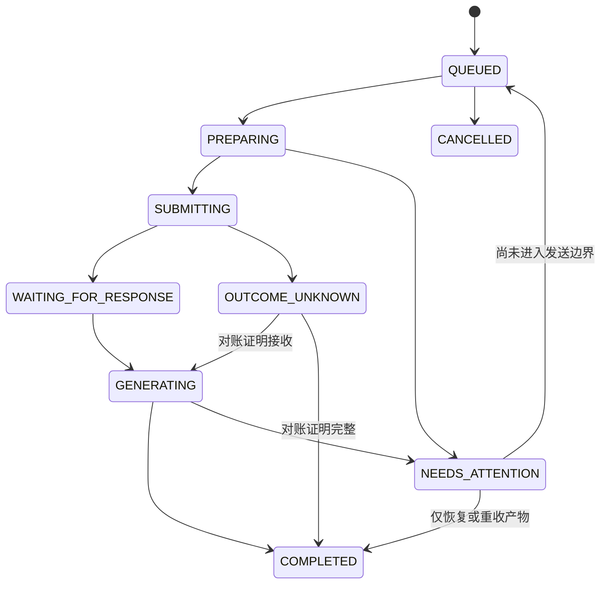

# 架构与恢复

## 模块

- `server.py`：MCP、普通 HTTP API、网络限制及二进制下载。
- `service.py`：任务调度、状态机、对账及产物打包。
- `store.py`：SQLite 事务、会话映射、消息意图、事件和幂等。
- `adapter.py`／`browser.mjs`：单一 Ego 执行器和实际网页适配。
- `artifacts.py`：私有文件缓存、原子提交、大小／签名／SHA-256 验证。
- `auth.py`／`webui.py`：`.env` 身份、一年浏览器登录、管理界面及同源保护。
- `exports.py`：仅 UI 的只读 ZIP 导出，独立于普通查询记录。
- `backup.py`：SQLite 快照与已验证产物备份。

浏览器适配不更新数据库，业务逻辑不直接操作 DOM。MCP 与 CLI 都共用后台服务；stdio 是代理，不另启浏览器执行器。

## 运行目录与身份

默认运行目录 `~/apps/ego-chatgpt-bridge`，权限 0700。`.env`、数据库、私钥、产物和导出文件为 0600。虚拟环境也在该目录，源码可保留在任意检出目录。

`.env` 保存主 token、主身份名、额外调用方 token JSON 和独立的 WebUI 签名密钥。普通任务和产物按身份隔离。主 token 的 WebUI 登录另有账户级调试导出权限，额外 Agent 身份无该权限。

WebUI cookie 不含原始 token，只含签名的身份、过期时间和 token 指纹。保持一年；token 轮换后重启会使旧 cookie 失效。cookie 为 HttpOnly／Secure／SameSite=Strict，UI 写请求校验 Origin，token 不写 localStorage。`MCP 接入` 在用户显式请求时返回本身份配置供复制。

## 网络

设置具体 `host`，如 EasyTier 的 `10.126.126.11`；`allowed_hosts` 只包含该地址，`allowed_client_cidrs` 如 `10.126.126.0/24`。监听和来源检查同时生效，不信任 X-Forwarded-For。所有 UI、静态文件、登录、MCP 和文件下载都受到来源限制。

绑定地址不存在时启动失败，不回退到 0.0.0.0。修改地址后运行 renew-tls，更新客户端信任的公有证书，再重启。init 不覆盖已有 token 或证书。自签证书默认有效一年。

## 正常任务状态

创建与幂等记录在同一 BEGIN IMMEDIATE 事务进入 QUEUED。PREPARING 只核查和填写草稿。基线、页面标签、UI 模型核验落库后，SUBMITTING 与 submitted_at 原子提交，再执行一次发送。

完整允许转换见 model.py。重启时 PREPARING 可重新准备；SUBMITTING 进入 OUTCOME_UNKNOWN；等待和生成状态恢复观察。不能因调用超时、断线或重启而自动重新发送。

SQLite 使用 WAL、synchronous=FULL、foreign_keys 和启动 quick_check，损坏时停止，不重建空库。文件与元数据不在同一事务中，使用先验证并原子重命名、再发布 AVAILABLE 的协议；中断可根据已有文件对账。

默认最多两个跨会话活跃任务，Ego 操作始终串行，同一 Conversation 按顺序发送。未知结果和已提交的 NEEDS_ATTENTION 继续占槽，防止网页可能仍生成时无限创建新任务。

运行目录 flock 防止多写入进程，用户 apps 目录内的 space-locks 防止不同运行目录争抢同一 Ego 空间。它不能阻止用户或非协作程序操作浏览器，因此另做空间、会话和历史校验。

## 页面及产物

空间按稳定 ID 和名称核对；丢失不新建空空间冒充恢复，用户接管时停止。页面标签只是提示，失效后使用已验证 Conversation ID 和 URL 重连，不猜标题。

模型仅允许 GPT-6，高／极高。超出要求的选择会停止。模型核验强度为网页 UI，不证明后端实际模型；账户显示名核验也不是稳定唯一的账户 ID。

回复完整依赖可见完成状态与输出控件。图片等无文字回复也可完成。文件需真实非零字节、类型检查与 SHA-256；下载错误仅重收产物，不自动重新生成。可见而未支持原始导出的音视频／交互内容显式报部分交付。

文件卡片由实际 UI 下载动作得到资源地址，使用浏览器语义保存字节；不构造隐藏请求、不读取／复制认证头。原始图片从当前回答的实际渲染资源取得，外部站点图片不会被服务器任意抓取。

## 故障处理

| 错误 | 处理 |
| --- | --- |
| SPACE_MISSING | 找回原空间，或明确初始化新空间后重新核验已有会话；不假称恢复 |
| SPACE_USER_CONTROL | 完成人工操作后显式接管专用空间，服务不自动夺回 |
| LOGIN_REQUIRED／ACCOUNT_MISMATCH | 在 Ego 中核对登录和账户 |
| PAGE_LOAD_FAILED | 同页有限刷新后仍失败则检查网络／專案 |
| HISTORY_NOT_CONFIRMED／MESSAGE_NOT_LOADED | 等待完整历史，核对消息 ID、实际 URL 和人工修改 |
| OUTCOME_UNKNOWN | recover_session 对账；无法确认则保留现场，没有强制重发接口 |
| ARTIFACT_EMPTY／ARTIFACT_INCOMPLETE | 不标记可用，重新收集对应产物 |
| ARTIFACT_INTEGRITY_FAILED | 本地缓存变化，拒绝提供错误字节 |
| MODEL_SELECTION_CHANGED | 核对 GPT-6 和高／极高，不切换禁止配置制造成功 |

先用 diagnose 查看阶段、原始错误原因的脱敏摘要、状态事件和 blocked_predecessor。`scripts/manage.py` 只管理本服务，不关闭 Ego；不会安装开机自启。

## 调试 ZIP

仅主身份 WebUI cookie 可访问导出入口，Bearer-only 及额外 Agent 身份不能直接使用。导出在同一个浏览器 actor 中串行执行，打开单独的只读页面，核对精确 Conversation ID，允许固定專案之外的已登录对话。

ZIP 包含 transcript.md、transcript.json、manifest.json、已验证产物和缺失项。它不读取 Cookie、Session Token 或请求认证头，也不向会话发送消息、修改模型或创建普通 Query。导出可为 PARTIAL，长对话历史分页未验证时会明确记录，不能称为全量历史保证。

## 备份与清理

`backup --include-artifacts` 原子生成 ZIP，含一致 SQLite 快照及 AVAILABLE 产物，复制时再次验证 SHA-256。损坏、缺失或复制期间变化会失败，不发布假备份。普通 backup 只保存数据库；调试 ZIP 可重新导出，不包含在主备份中。

`.env` 和 TLS 私钥需单独安全保管。恢复前停止服务、保留现有 DB/WAL/SHM；恢复后逐条对账。旧备份之外可能已经发送的操作不能自动重发。delete_query 只作本地逻辑清理，不删除远端对话，不承诺磁盘安全擦除。
