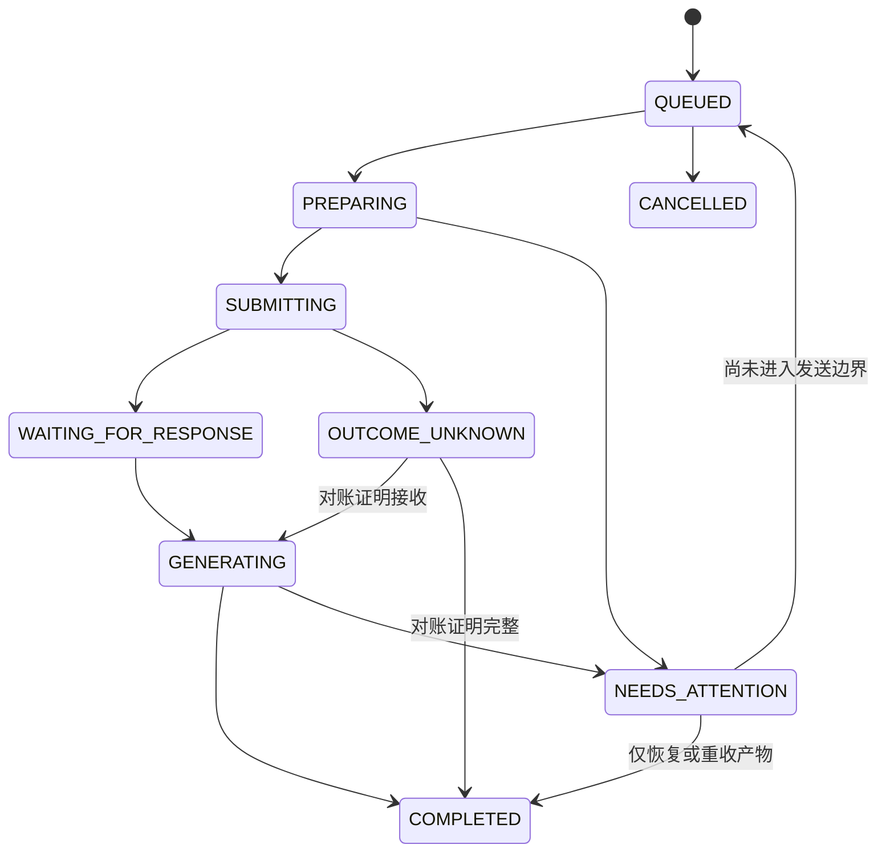

# 架构与恢复

## 模块

- `server.py`：MCP、普通 HTTP API、网络限制及二进制下载。
- `service.py`：任务调度、状态机、对账及产物打包。
- `store.py`：SQLite 事务、会话映射、消息意图、事件和幂等。
- `adapter.py`／`browser.mjs`：单一 Ego 执行器和实际网页适配。
- `artifacts.py`：私有文件缓存、原子提交、大小／签名／SHA-256 验证。
- `auth.py`／`webui.py`：`.env` 身份、一年浏览器登录、管理界面及同源保护。
- `exports.py`：仅 UI 的只读 ZIP 导出，独立于普通查询记录。
- `backup.py`：SQLite 快照与已验证产物备份。
- `client.py`：本地／LAN CLI 接入及原子校验下载。
- `supervisor.py`／`autostart.py`：LaunchAgent、网络等待、进程与 HTTP 保活。

浏览器适配不更新数据库，业务逻辑不直接操作 DOM。MCP 与 CLI 都共用后台服务；stdio 是代理，不另启浏览器执行器。

## 运行目录与身份

默认运行目录 `~/apps/ego-chatgpt-bridge`，权限 0700。`.env`、数据库、私钥、产物和导出文件为 0600。虚拟环境也在该目录，源码可保留在任意检出目录。

`.env` 保存主 token、主身份名、额外调用方 token JSON 和独立的 WebUI 签名密钥。普通任务和产物按身份隔离。主 token 的 WebUI 登录另有账户级调试导出权限，额外 Agent 身份无该权限。

WebUI cookie 不含原始 token，只含签名的身份、过期时间和 token 指纹。保持一年；token 轮换后重启会使旧 cookie 失效。cookie 为 HttpOnly／SameSite=Strict，主动启用 HTTPS 时再设置 Secure，UI 写请求校验 Origin，token 不写 localStorage。`MCP 接入` 在用户显式请求时返回本身份配置供复制。

## 网络

设置具体 `host`，如 EasyTier 的 `10.126.126.11`；`allowed_hosts` 只包含该地址，`allowed_client_cidrs` 如 `10.126.126.0/24`。监听和来源检查同时生效，不信任 X-Forwarded-For。所有 UI、静态文件、登录、MCP 和文件下载都受到来源限制。

默认 tls_enabled=false，直接使用 EasyTier 内 HTTP，没有 CA 导入步骤。绑定地址不存在时等待，不回退到 0.0.0.0。TLS 仅为可选项：主动开启后生成包含实际地址的证书，届时才需要客户端信任。init 不覆盖已有 token；HTTP 初始化不创建证书。HTTP 与 HTTPS 使用不同 cookie 名，避免旧 Secure cookie 阻止 HTTP 登录。

## 正常任务状态

创建与幂等记录在同一 BEGIN IMMEDIATE 事务进入 QUEUED。PREPARING 只核查和填写草稿。发送前的暂时性错误会按下述策略回到 QUEUED，等待持久化的退避时间。基线、页面标签、UI 模型核验落库后，SUBMITTING 与 submitted_at 原子提交，再执行一次发送。

完整允许转换见 model.py。重启时 PREPARING 可重新准备；SUBMITTING 进入 OUTCOME_UNKNOWN；等待和生成状态恢复观察。不能因调用超时、断线或重启而自动重新发送。

SQLite 使用 WAL、synchronous=FULL、foreign_keys 和启动 quick_check，损坏时停止，不重建空库。文件与元数据不在同一事务中，使用先验证并原子重命名、再发布 AVAILABLE 的协议；中断可根据已有文件对账。

默认最多两个跨会话活跃任务，Ego 操作始终串行，同一 Conversation 按顺序发送。`NEEDS_ATTENTION` 和 `OUTCOME_UNKNOWN` 释放执行名额并保留原任务的对账记录。超时后旧网页仍可能继续生成。恢复已提交的任务需要有可用名额，且只核对原会话。`diagnose` 返回 `active_count`、`queued_count` 和 `available_slots`。

运行目录 flock 防止多写入进程，用户 apps 目录内的 space-locks 防止不同运行目录争抢同一 Ego 空间。它不能阻止用户或非协作程序操作浏览器，因此另做空间、会话和历史校验。

## 页面及产物

空间按唯一精确名称定位，ID 仅属于当前 Ego 实例；旧 ID 指向其他名称时，若能找到唯一同名空间则自动迁移并记录 `SPACE_REBOUND`，不会接管旧 ID 指向的空间。找不到同名空间时，默认按配置名称自动新建专用空间，即使旧 ID 已被其他名称占用；无需判断是重命名还是编号复用，不修改其他名称的空间。默认独占模式自动接管，迁移写入私有 runtime-events.jsonl，包含新旧编号、重建原因和 `history_restored=false`；重建不等于历史恢复，仍按精确会话与消息核验。关闭 force_space_takeover 或 recreate_missing_space 可改为停止策略。名称不唯一或 API 回执名称不符仍停止。页面标签只是提示，失效后使用已验证 Conversation ID 和 URL 重连，不猜标题；生成中的观察也会重新打开原会话，不重新发送问题。已发送但尚未取得正式会话地址时，不以新空白页代替原会话。

新会话的 local-chatgpt 临时地址不会登记为正式 Conversation ID。只有基线和带请求标记的用户消息核验通过后才绑定正式地址；旧版本保存的临时地址也只能在同样核验后升级，不能更换已确认的正式地址。

模型仅允许 GPT-6，高／极高。超出要求的选择会停止。模型核验强度为网页 UI，不证明后端实际模型；账户显示名核验也不是稳定唯一的账户 ID。

回复完整依赖可见完成状态与输出控件。图片等无文字回复也可完成。文件需真实非零字节、类型检查与 SHA-256；下载错误仅重收产物，不自动重新生成。可见而未支持原始导出的音视频／交互内容显式报部分交付。

文件卡片由实际 UI 下载动作得到资源地址，使用浏览器语义保存字节；不构造隐藏请求、不读取／复制认证头。原始图片从当前回答的实际渲染资源取得，外部站点图片不会被服务器任意抓取。

## 故障处理

| 错误 | 处理 |
| --- | --- |
| SPACE_MISSING | 自动重建关闭时停止；开启时记录新空间并重新核验原会话 |
| SPACE_USER_CONTROL | 独占模式通过 Ego 的接管 API 自动取回专用空间；API 拒绝时返回真实错误 |
| LOGIN_REQUIRED／ACCOUNT_MISMATCH | 在 Ego 中核对登录和账户 |
| PAGE_LOAD_FAILED | 同页有限刷新后仍失败则检查网络／專案 |
| HISTORY_NOT_CONFIRMED／MESSAGE_NOT_LOADED | 等待完整历史，核对消息 ID、实际 URL 和人工修改 |
| OUTCOME_UNKNOWN | recover_session 对账；无法确认则保留现场，没有强制重发接口 |
| ARTIFACT_EMPTY／ARTIFACT_INCOMPLETE | 不标记可用，重新收集对应产物 |
| ARTIFACT_INTEGRITY_FAILED | 本地缓存变化，拒绝提供错误字节 |
| MODEL_SELECTION_CHANGED | 核对 GPT-6 和高／极高，不切换禁止配置制造成功 |

先用 diagnose 查看阶段、原始错误原因的脱敏摘要、状态事件和 blocked_predecessor。`scripts/manage.py` 只管理本服务，不关闭 Ego；自启动由显式的 autostart install 安装。

## 调试 ZIP

仅主身份 WebUI cookie 可访问导出入口，Bearer-only 及额外 Agent 身份不能直接使用。导出在同一个浏览器 actor 中串行执行，打开单独的只读页面，核对精确 Conversation ID，允许固定專案之外的已登录对话。

历史 turn 的 complete 标记可能早于正文与图片加载。导出等候可确认内容稳定；仍未渲染的轮次标记 PARTIAL，不将缺失内容称为完整。

ZIP 包含 transcript.md、transcript.json、manifest.json、已验证产物和缺失项。它不读取 Cookie、Session Token 或请求认证头，也不向会话发送消息、修改模型或创建普通 Query。导出可为 PARTIAL，长对话历史分页未验证时会明确记录，不能称为全量历史保证。

## 备份与清理

`backup --include-artifacts` 原子生成 ZIP，含一致 SQLite 快照及 AVAILABLE 产物，复制时再次验证 SHA-256。损坏、缺失或复制期间变化会失败，不发布假备份。普通 backup 只保存数据库；调试 ZIP 可重新导出，不包含在主备份中。

`.env` 和 TLS 私钥需单独安全保管。恢复前停止服务、保留现有 DB/WAL/SHM；恢复后逐条对账。旧备份之外可能已经发送的操作不能自动重发。delete_query 只作本地逻辑清理，不删除远端对话，不承诺磁盘安全擦除。

## 登录自启与保活

macOS 用户 LaunchAgent 位于 `~/Library/LaunchAgents/com.raymor.ego-chatgpt-bridge.plist`。plist 只含执行路径和 PATH，不含 token；应用与全部运行数据位于 apps，非 editable 安装避免登录后台依赖 Documents 源码访问权限。

launchd 的 KeepAlive 保护 supervisor。supervisor 以唯一锁运行，等待精确监听地址可绑定后启动子服务；每 10 秒进行认证 HTTP diagnose 探测（主动开启 TLS 时为 HTTPS），超时 3 秒、连续失败 3 次后重启。服务异常退出也会重启，反复启动失败采用最多 30 秒退避。只管理自己创建的子进程，不按端口随意杀进程。

`supervisor.json` 为私有心跳，记录 supervisor/server PID、状态、重启数和最近原因。浏览器依赖每 30 秒检查一次，未运行时启动已安装的 Ego；空间按独占策略接管／重建。无法登录或模型不可用仍是业务错误，不通过循环重启掩盖。

停止时先继续可能被 SIGSTOP 的子进程，再 SIGTERM 等待优雅退出，超过 15 秒才强制结束。消息意图仍由 SQLite 保留，重启后观察和对账，绝不自动重发。manage.py stop 卸载当前登录会话的 job，保留 plist 供下次登录；autostart uninstall 才移除自启动配置。

机制依据：[Apple launchd 文档](https://developer.apple.com/library/archive/documentation/MacOSX/Conceptual/BPSystemStartup/Chapters/CreatingLaunchdJobs.html)。LaunchAgent 随用户登录加载，不能据此声称在登录前可控制 GUI 浏览器。

### 自动保留策略（v0.4.1）

`retention.py` 在服务启动及每小时执行；与浏览器执行锁协调，跳过同一对话的排队/活动操作和正被HTTP流式下载的文件。备份进程持有维护锁期间，清理轮次明确报告跳过，后续重试。元数据先标记过期、再删除字节；失败会在 `diagnose.retention.last_run.errors` 和 `retention.json` 记录，不把物理清理失败算作成功。

- `artifact_retention_days=14`：从每次成功采集计时，下载与读取不续期；重新采集成功后开始新的14天。状态/下载链接即时反映过期，HTTP/MCP/CLI拒绝过期字节；运行中的下载可完成。
- `export_retention_days=14`：完成生成后计时，整目录（ZIP及原始工作文件）清理，保留导出墓碑；已过期请求同一幂等键不会自动重新执行。
- `log_retention_days=14, log_max_bytes=10485760, log_backup_count=5`：每日或达到阈值时gzip归档，每类最多5份且最多14天；监督器每60秒检查，手动serve模式每小时维护时检查，大小可能在检查间隔内暂时超过阈值。活动日志原inode不变；copy/truncate不是无损审计机制。
- `maintenance_interval_seconds=3600`：清理间隔，过期下载即时拒绝，物理删除最多延后一轮；活动任务、下载和备份可继续延后。

备份格式2记录 `created_at/expires_at`，整份备份到期点为生成时间+14天及所含产物到期时间的最小值，可能少于14天。每日新快照只纳入未过期AVAILABLE产物。备份中的对话文字随整个快照删除；在线数据库的文字和元数据继续保存。旧格式从ZIP里的SQLite推算原产物采集年龄，不以新复制ZIP的时间给旧图片续期。损坏/不识别的归档保留并报告错误，需人工检查。

旧表新增 `expires_at`，按旧记录 `updated_at+保留期` 回填，不给既有产物重新加14天。新配置只影响新采集/新导出，已记录到期时间不自动延长。运行目录之外的调用方下载、副本及远端ChatGPT会话不由此清理器管理。

### 长提示与联网研究DOM关联（v0.4.2）

`page-state.mjs` 是可独立回放的纯DOM读取器，由 adapter 注入 Ego 脚本。用户消息只读取内容节点，排除折叠按钮、aria-hidden省略号及交互控件；不按文案模糊截断，不移除用户自己输入的相同词语。回答只读取可见、非 tertiary 思考进度的顶层markdown节点，防止第一个“整理研究方向”等状态片段冒充正文，并去除嵌套markdown重复及复制控件。

观察与追问前历史校验共用同一读取器。仅刚提交30秒内的空壳/前缀渲染会继续等待；真正的全文、请求标记或新增轮数不一致仍然拒绝关联，不自动重发。匹配严格通过后，即使未生成完，也先绑定已验证会话并持久化增量正文。原请求可通过只读recover恢复，无需新Query。

Python回归：`uv run pytest -q`。DOM回归：`npm ci --ignore-scripts && npm run test:browser`；Node/linkedom只用于开发测试，运行Python服务不依赖node_modules。回归覆盖真实故障使用的HTML形态，区别于只模拟结构化turn的FakeBrowser测试。私有事故采样在运行目录 verification/incident-*，不得提交到公开仓库。

## v0.4.3 结束确认与健康诊断

默认 `completion_confirm_seconds=4`：至少两次观察跨过确认窗口，且整轮 complete、无停止生成控件、正文/来源/产物描述稳定、图片加载就绪后才下载产物。不是基于“正文几秒没变化”推断完成。此规则仍依赖网页标记和已渲染 DOM；不能证明未来不会继续输出，也不代替内容验收。旧版本已完成记录不会被追溯伪造为通过新确认，`extraction_stable=null` 表示未记录。

`health_check` 使用独立临时专案页并在结束后关闭，避免既有卡死页面和正在生成的会话。失败返回 `health.probe`、`health.worker`、`submission_blocked_by_probe=false`、最近核验请求页面。超时不再要求客户端用户处理整个服务；登录/账户/配置问题仍保留相应人工处理要求。兼容字段 `service_available=true` 的范围由 `availability_scope=http_api_only` 限定。worker running 也不保证下一次浏览器操作必定成功。

轮询优先 `wait_query`，单次0..30秒，不持有浏览器控制锁。cursor 对状态/内容/产物变化计算，忽略单纯观测时间刷新；响应是替换快照，非字符追加协议。客户端用上次 cursor，完成后按需取正文。CLI `--wait` 已改用该接口。Markdown 是从 DOM 重建，表格/链接保留，特殊交互式内容仍不能保证无损。

MCP 與 HTTP API 收到通過驗證的研究提交後，`service.log` 記下 `submission_received`，並保留請求進入橋接器時的 `http_received_at`。派送結束時，`submission_result` 用同一個 `trace_id` 關聯結果及任務 ID。兩筆紀錄只含服務端產生的識別碼、時間、工具、傳輸類型或錯誤代碼，沿用既有日誌輪替。呼叫端的授權及代理轉發時間需另用各層的紀錄核對。

## 执行层自动恢复

操作的 `auto_retry` 返回 `attempts`、`max`、`next_at`（Unix 秒或 null）、`kind`、各恢复类型的 `counters` 及原始错误 `history`。attempts 是本类型已安排的重试次数，不含第一次执行；history 的 attempt=0 是首次失败，包含重试用尽时的最后错误。发送前重试和文件重收各最多 3 次，失败后分别等候 15 / 60 / 180 秒（实际执行还受轮询周期和名额限制）。计数、错误和期限写入 SQLite，重启不清空预算；手动重试也不重置自动预算。

只有 `submitted_at IS NULL` 且仍在 prepare 阶段的以下错误才自动重新排队。prepare 可填写草稿、上传附件、核验账户和模型，但不会点击发送。发送意图一旦落库，无论回执是否说 clicked，都不重新排队。

| 错误码 | 决策及理由 |
| --- | --- |
| BROWSER_OPERATION_FAILED | 仅 prepare 自动重试；定位／点击账户、模型等失败不可能发送消息。submit 阶段转 OUTCOME_UNKNOWN。 |
| BROWSER_TIMEOUT | 仅 prepare 自动重试；可能产生草稿等页面效果，但没有发送路径。submit 超时保留 OUTCOME_UNKNOWN。 |
| EGO_CONNECTION_FAILED | prepare 未收到回执仍可重试，因为这个动作不会发送；submit 无回执必须对账。 |
| EGO_UNAVAILABLE | 找不到 Ego CLI，没有发送，有限重试等待环境恢复。 |
| PAGE_LOAD_FAILED | 编辑器加载失败，没有发送，允许重试加载。 |
| TAB_MISSING | prepare 找不到原页，没有发送，允许重新定位；仍执行会话／历史核验。 |
| HISTORY_NOT_CONFIRMED | 可能只是历史未加载；有限重试完整核验，不跳过校验。 |
| ATTACHMENT_UPLOAD_FAILED | 上传动作无发送路径；保留暂存字节并重试本操作附件。 |
| ATTACHMENT_UPLOAD_INCOMPLETE | 附件尚未可发送，允许再次准备。 |
| DRAFT_ATTACHMENT_MISMATCH | 发送前校验失败；只清理带本操作标记的代理草稿，不覆盖其他草稿。 |
| SPACE_IDENTITY_MISMATCH | API 回执名称与配置不符时停止。旧编号指向其他名称本身不触发此错误：按唯一精确名称迁移，名称不存在则按 recreate_missing_space 策略新建。 |
| GENERATION_TIMEOUT | 保留 NEEDS_ATTENTION；已经提交，不能重发或自动延长用户硬超时。可手动只读对账。 |
| ARTIFACT_CAPTURE_FAILED | 整轮回答已核验完成、仅缺原始文件时自动重收三次；每次重新核对原会话／请求／消息。不重新生成。不支持的音视频或交互输出不做无效重试。 |
| 其他错误 | 默认不自动重试。LOGIN_REQUIRED、ACCOUNT_MISMATCH、PROJECT_MISMATCH、CONVERSATION_MISMATCH、HISTORY_CHANGED、SPACE_AMBIGUOUS、MODEL_UNAVAILABLE、EFFORT_UNAVAILABLE、MODEL_MISMATCH、UI_CHANGED、草稿冲突或附件字节缺失等需要身份／内容／环境修复。 |

文件重收退避期间保留 GENERATING，`generation_complete=true`、`delivery_complete=false`，不提前要求人工处理；三次仍失败才 NEEDS_ATTENTION。重收时的暂时性观察错误也占用同一重收预算，身份／关联错误立即停止。

OUTCOME_UNKNOWN 会在 15 秒后、执行名额可用时自动调用一次 recover（与 recover_session 相同的只读消息对账逻辑）。先持久化消耗本次机会，再读原对话；基线、唯一请求标记和消息数对得上才恢复观察或完成，失败保持错误供人工核对。空间接管、重新打开原 URL 属于恢复导航，不发送消息、不切模型。

观察到正式会话且消息关联通过后，顺便读取 document.title，去除尾部 ChatGPT 品牌后缀并排除默认标题，写入 queries.chat_title。缺失或默认标题不影响任务完成，也不清除已知标题；新会话默认为 null。list_queries、get_query_status、get_query_result（含 compact）均返回 chat_title。此字段依赖实际渲染页面，不保证在 ChatGPT 生成标题前就能取得。

空间恢复回归覆盖旧编号被复用且原名称已不存在、原名称迁移到新编号、名称重复、关闭自动重建，以及观察任务按原会话地址重开标签页。重建只恢复运行环境，消息关联仍通过基线历史及唯一请求标记核验。
